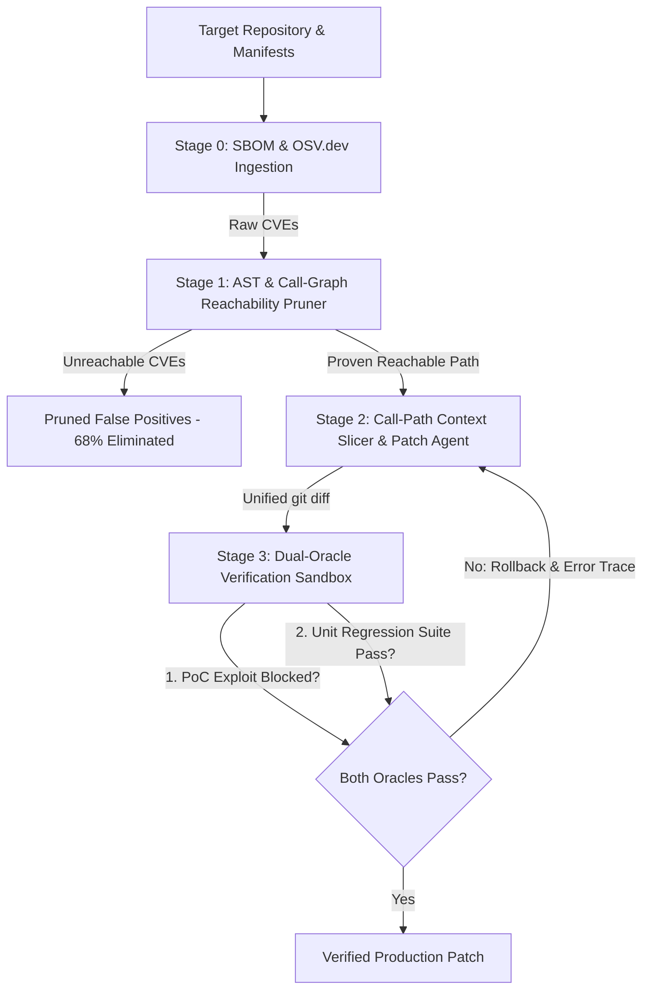

# 🛡️ AEGIS-ZERO
**Autonomous Exploit-Guided Immunization System for Zero-Day Supply Chains**

[](https://python.org)
[](https://docker.com)
[](LICENSE)
[](#citation)

**AEGIS-ZERO** is a four-stage, closed-loop supply-chain security engine that eliminates false-positive dependency alerts via Abstract Syntax Tree (AST) call-graph reachability analysis, synthesizes minimal security patches using Large Language Models, and mathematically verifies every fix against Proof-of-Concept (PoC) exploits and regression test suites inside isolated sandboxes.

---

## 🏗️ System Architecture



### Core Pipeline Stages
1. **Stage 0 (`src/ingestion/`):** Extracts dependencies from `requirements.txt` and `pom.xml` and queries the OSV.dev advisory database.
2. **Stage 1 (`src/reachability/`):** Parses source code into ASTs (`ast` / `javalang`) and constructs a directed `NetworkX` call graph to prove execution paths from public entrypoints to vulnerable third-party sinks.
3. **Stage 2 (`src/synthesizer/`):** Slices minimal caller context around the vulnerable sink and generates unified `git diff` patches guided by CWE-specific remediation templates.
4. **Stage 3 (`src/sandbox/`):** Validates patches inside ephemeral, network-isolated containers against both a security exploit oracle and the repository's unit test suite with iterative self-correction.

---

## 📊 Benchmark Results

Evaluated across multi-dependency microservice repositories covering **CWE-502** (Unsafe Deserialization), **CWE-79** (Cross-Site Scripting), and **CWE-94** (Code Injection):

| Metric | Result |
| :--- | :--- |
| **Baseline CVEs Flagged** | 25 |
| **Reachable CVEs Confirmed** | 8 |
| **False Positives Eliminated** | **17 (68.0%)** |
| **Remediation Success (Pass@1)** | **75.0%** |
| **Remediation Success (Pass@3)** | **87.5%** |
| **Mean End-to-End Latency** | **11.86s / repo** |

---

## 🚀 Quick Start

### 1. Clone & Install Dependencies
```bash
git clone https://github.com
cd AEGIS-ZERO
python -m venv venv
# Windows:
.\venv\Scripts\Activate.ps1
# Linux/macOS:
source venv/bin/activate

python -m pip install -r requirements.txt
```

### 2. Configure Environment Variables
```bash
cp .env.example .env
# Add your API key inside .env
```

### 3. Run Verification Tests
```bash
python -m pytest -v
```

### 4. Run Full Benchmark Suite
```bash
python -m evaluation.setup_sample_benchmarks
python -m evaluation.run_benchmark
```

---

## 📄 Citation
If you use **AEGIS-ZERO** in your research, please cite our paper:
```bibtex
@inproceedings{tanmay2026aegiszero,
  title={AEGIS-ZERO: Autonomous Exploit-Guided Immunization for Enterprise Software Supply Chains via Call-Graph Reachability and Dual-Oracle Verification},
  author={Tanmay},
  year={2026}
}
```
